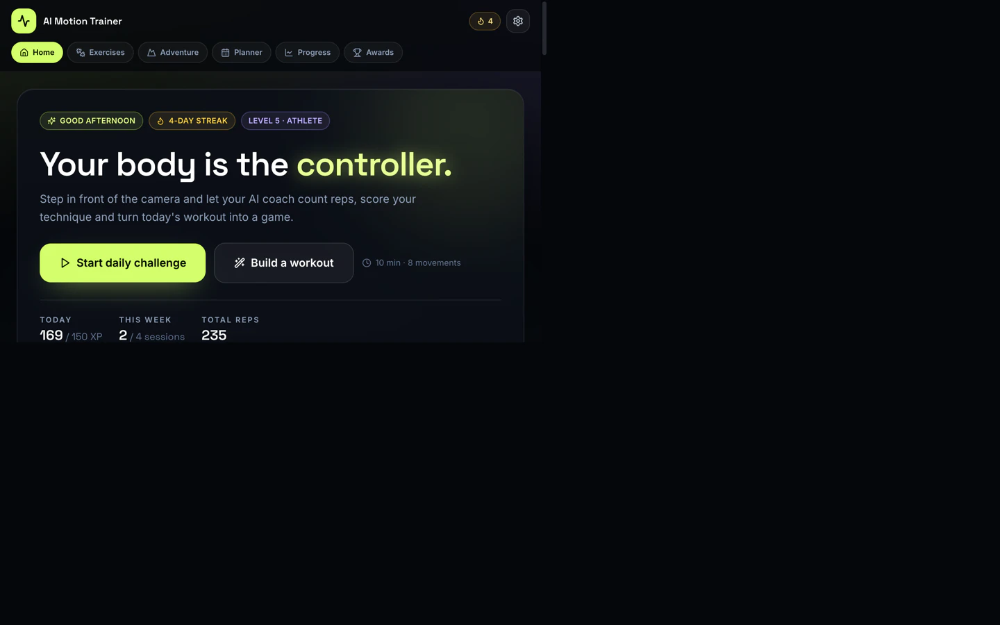
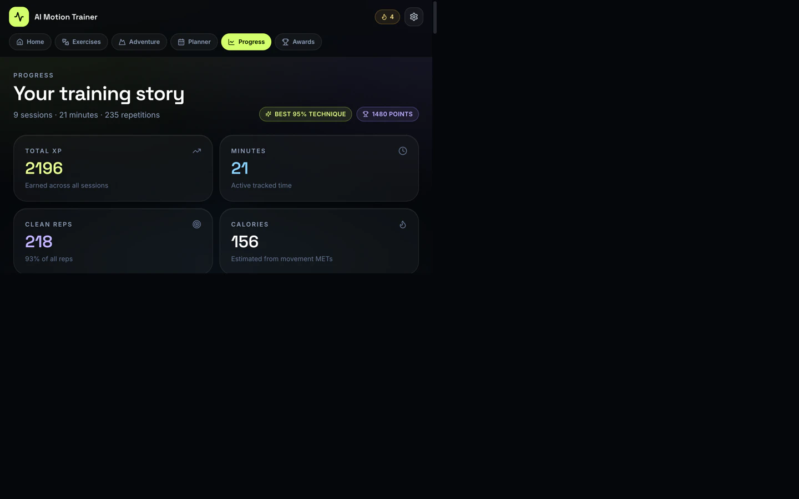
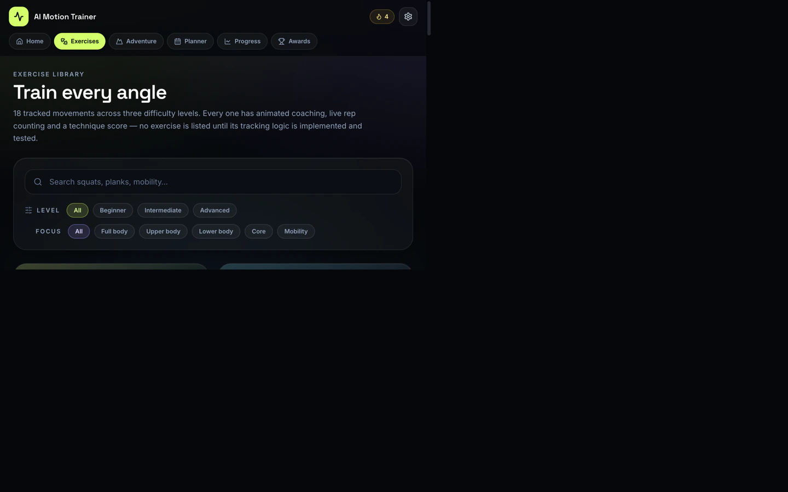
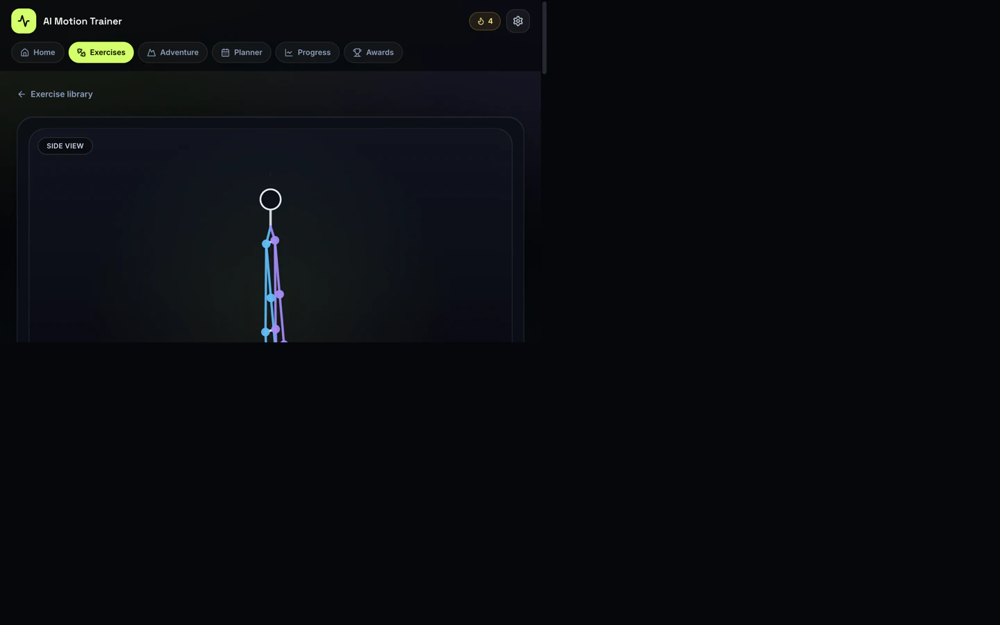
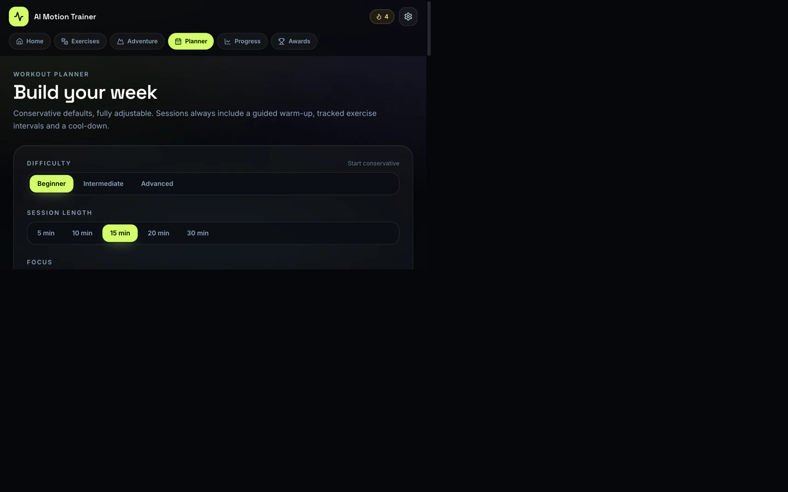
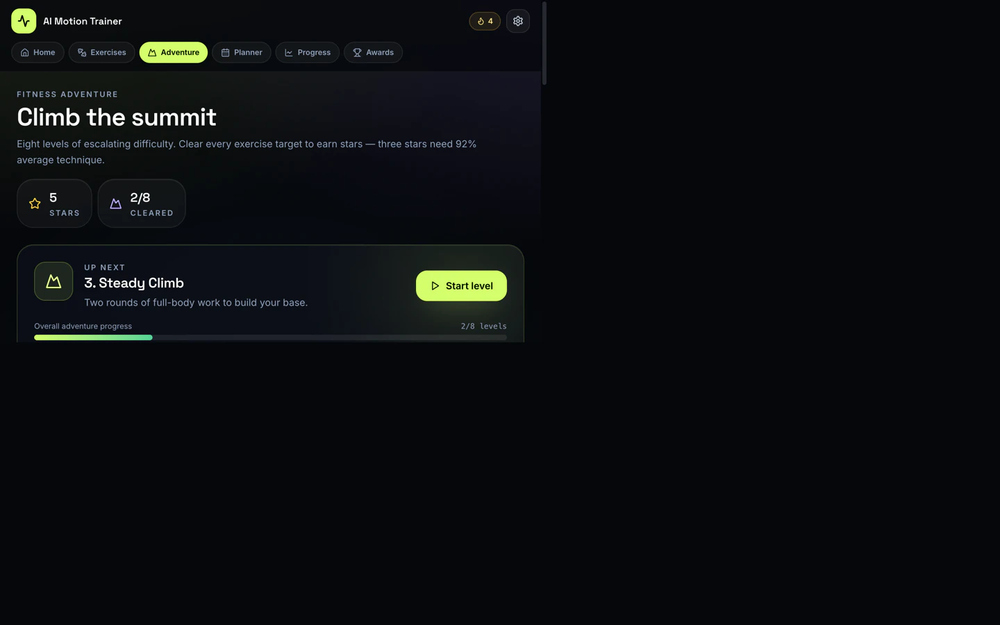
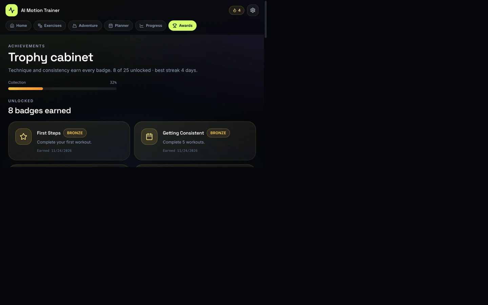
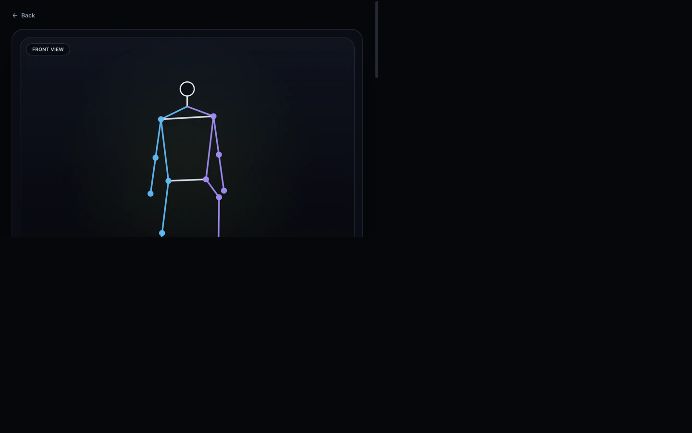

# AI Motion Trainer

A camera-driven fitness game: your webcam becomes the controller, MediaPipe Pose
Landmarker reads your body, and exercise-specific state machines count clean reps
and score your technique in real time.

Everything runs in the browser. Video frames are never recorded, uploaded, or sent
to any API.

   

---

## Screenshots

Captured at 1440 × 900 from a **seeded demo profile** (nine sessions across two weeks),
so every chart, streak and progress value below is genuine app output.

| Gamified dashboard | Progress & technique trends |
| --- | --- |
| [](docs/screenshots/dashboard.webp) | [](docs/screenshots/progress.webp) |
| Daily XP ring, streak, four game modes and quick-start cards. | XP per day, eight-week technique trend, records and history. |

| Exercise library | Exercise detail & technique guide |
| --- | --- |
| [](docs/screenshots/exercises.webp) | [](docs/screenshots/exercise-detail.webp) |
| All 18 movements, searchable and filterable by difficulty and focus. | Animated demo, instructions, common mistakes and safety notes. |

| Workout planner | Fitness adventure |
| --- | --- |
| [](docs/screenshots/planner.webp) | [](docs/screenshots/adventure.webp) |
| Difficulty, duration, focus, impact and training days → full session. | Eight levels with star ratings, level gating and clear bonuses. |

| Achievements | Session preview |
| --- | --- |
| [](docs/screenshots/achievements.webp) | [](docs/screenshots/workout-intro.webp) |
| 25 badges for streaks, volume, technique and exploration. | Warm-up → tracked intervals → cool-down, before the camera starts. |

> The live tracking HUD is intentionally **not** screenshotted: it renders your webcam
> feed, so publishing it would leak the operator's room. Run `npm run dev` and start a
> session to see the mirrored video, skeleton overlay, rep counter and coaching cues.

---

## Table of contents

- [Screenshots](#screenshots)
- [What actually works](#what-actually-works)
- [Requirements](#requirements)
- [Install and run on macOS](#install-and-run-on-macos)
- [Scripts](#scripts)
- [How a session works](#how-a-session-works)
- [Exercise library](#exercise-library)
- [Game modes](#game-modes)
- [Gamification and scoring](#gamification-and-scoring)
- [Workout planner](#workout-planner)
- [Architecture](#architecture)
- [Testing](#testing)
- [Privacy model](#privacy-model)
- [Performance notes](#performance-notes)
- [Troubleshooting](#troubleshooting)
- [Limitations](#limitations)

---

## What actually works

This is not a UI prototype. The end-to-end loop is implemented and tested:

- **Real pose inference** with MediaPipe Pose Landmarker (bundled model + WASM,
  local-first with CDN fallback).
- **Calibration gate** before every session: camera permission, full-body framing,
  lighting/landmark confidence, neutral-stance hold. Reps cannot be counted until
  calibration completes.
- **Exercise-specific trackers** (state machines with hysteresis, cooldown,
  minimum cycle time, visibility checks, distance-normalised angles) for the whole
  library, including per-side counting for lunges, push-ups, knee raises and
  shoulder taps, hold tracking for planks/wall sits/balance, and a five-phase
  burpee machine.
- **Live HUD**: mirrored webcam, skeleton overlay, rep/hold counter, target, timer,
  technique score, XP/points, progress bar, coaching cues in green/amber/red.
- **Audio feedback**: Web Audio synth cues (count, tick, finish, level-up) and
  optional speech synthesis coaching.
- **Six game modes**, XP/levels, daily streaks, daily goals, 25 achievements,
  personal records, workout history, exercise statistics and weekly charts.
- **Persistence** in `localStorage`, with schema sanitising and a privacy reset.
- **Planner** that generates warm-up → intervals → cooldown sessions from
  difficulty, duration, focus, impact level and training frequency.
- **162 automated tests** covering geometry, calibration, every tracker, the engine,
  planner, progression, storage, camera errors, session aggregation, routing and a
  full pose→rep→set-complete UI integration.

Trackers are only exposed in the UI because their logic exists and is tested. See
[docs/EXERCISE_TRACKING.md](docs/EXERCISE_TRACKING.md) for thresholds and algorithms.

## Requirements

| Requirement | Notes |
| --- | --- |
| macOS 12+ (Apple Silicon recommended) | Developed and verified on macOS |
| Node.js 20+ | Node 22/25 also work; `node --version` |
| npm 10+ | Ships with Node |
| Chrome, Edge or Safari 17+ | Chrome recommended for MediaPipe GPU delegate |
| Webcam | Built-in FaceTime camera is fine |
| Space | 2–3 m in front of the laptop, full body visible |
| Network (first run only) | `npm install` and model download; inference itself is offline |

## Install and run on macOS

```bash
git clone <this-repository> ai-motion-trainer
cd ai-motion-trainer
npm install
npm run dev
```

Open <http://localhost:5173>, allow camera access when the browser asks, and pick a
workout.

`npm run dev` automatically runs `prepare:assets`, which:

1. Copies the MediaPipe WASM runtime from `node_modules/@mediapipe/tasks-vision/wasm`
   into `public/wasm`.
2. Downloads `pose_landmarker_lite.task` (~5.8 MB) into `public/models` if missing.

Both directories are git-ignored. If the model cannot be downloaded, the app falls
back to the jsDelivr/Google Storage CDN at runtime, so the first workout still works
online.

### Camera permission on macOS

- Browser prompt: choose **Allow**.
- If you previously blocked it: **Safari → Settings → Websites → Camera**, or
  **Chrome → Settings → Privacy and security → Site settings → Camera**, then
  reload.
- macOS may also ask at the OS level: **System Settings → Privacy & Security → Camera**
  → enable your browser.

Camera APIs require a secure context. `http://localhost` counts as secure; a LAN IP
over plain HTTP does not.

### Production build

```bash
npm run build     # type-check + prepare assets + bundle into dist/
npm run preview   # serve dist/ locally
```

Serve `dist/` from any static host. Keep `dist/models` and `dist/wasm` alongside
`index.html` for fully offline inference.

## Scripts

| Command | What it does |
| --- | --- |
| `npm run dev` | Prepare assets and start Vite with HMR |
| `npm run build` | `tsc --noEmit` + production bundle |
| `npm run preview` | Preview the production build |
| `npm test` | Run the full Vitest suite once |
| `npm run test:watch` | Watch mode |
| `npm run typecheck` | TypeScript only |
| `npm run prepare:assets` | Copy WASM + fetch model (idempotent) |

## How a session works

1. **Intro** – animated demonstration, movement list, targets, safety notes.
2. **Camera + calibration** – live preview with a body-outline guide. Calibration
   requires five checks: camera running, head visible, ankles visible, body centred,
   enough light/landmark confidence. You then hold a neutral stance for ~2.4 s to
   capture a personal baseline (torso length, hip→ankle and hip→knee distances,
   shoulder width, ground line).
3. **Ready** – baseline locked; demo of the first movement; optional camera toggle.
4. **Training** – full-screen HUD, live skeleton, coaching cues, rep/hold counter,
   score, timer and progress. Rest blocks auto-advance; you can pause, skip a block
   or end the session.
5. **Summary** – per-set results, technique score, XP/points, records, achievements,
   level-up and adventure stars, plus "train again".

The engine **arms** only after ~500 ms of continuous valid tracking and **disarms**
after ~650 ms without a usable pose, so leaving the frame cannot generate reps.
Hold credit uses a watermark: pausing never grants retroactive hold time.

## Exercise library

| Exercise | Level | Metric | Default target |
| --- | --- | --- | --- |
| Bodyweight Squat | Beginner | reps | 12 |
| Standing Knee Raise | Beginner | reps | 16 |
| Standing Arm Raise | Beginner | reps | 12 |
| Jumping Jacks | Beginner | reps | 20 |
| Wall Sit | Beginner | hold | 30 s |
| Standing Torso Twists | Beginner | reps | 16 |
| Forward Lunges | Intermediate | reps / side | 12 |
| Push-Ups | Intermediate | reps | 10 |
| Plank | Intermediate | hold | 30 s |
| High Knees | Intermediate | reps | 30 |
| Mountain Climbers | Intermediate | reps | 24 |
| Burpees | Intermediate | reps | 8 |
| Jump Squats | Advanced | reps | 12 |
| Lateral Lunges | Advanced | reps | 12 |
| Single-Leg Balance | Advanced | hold / side | 30 s |
| Wide Push-Ups | Advanced | reps | 10 |
| Diamond Push-Ups | Advanced | reps | 8 |
| Plank Shoulder Taps | Advanced | reps | 16 |

Every exercise ships with an animated stick-figure demo, written instructions,
correct-position cues, common mistakes, tracking notes and safety guidance.

## Game modes

- **Free Training** – choose any movement and train at your own pace.
- **Daily Challenge** – deterministic workout for today's date, scaled to your level;
  completing it extends your streak.
- **Fitness Adventure** – eight levels with level gating, target requirements and
  1–3 stars based on technique.
- **Endurance** – as many clean reps as possible in a time limit.
- **Precision** – hit a rep target while holding an accuracy threshold; the accuracy
  bonus is only awarded when the target is met.
- **Planned Workout** – the generated warm-up → intervals → cooldown session.

## Gamification and scoring

- **Reps**: points `round(25 × (score/100)²)`, XP `round(9 × (score/100)²)`.
  Clean reps pay quadratically more, so sloppy volume never beats good form.
- **Holds**: `2.2 pts/s` and `1.4 XP/s`, scaled by quality².
- **Bonuses**: session completion +25 XP / +15 pts, daily challenge +30/+20,
  precision accuracy +40/+20, adventure clear bonus per level.
- **Levels**: `xpForLevel(n) = 250(n−1) + 50(n−1)²`.
- **Technique score** is a weighted blend of per-rep scores and hold quality; issues
  such as shallow depth, knee valgus, sagging hips or incomplete range reduce it with
  bounded penalties.
- **Streaks, daily goals, personal records and achievements** are derived from stored
  workout records, not from separate counters that can drift.

## Workout planner

Configure difficulty (beginner / intermediate / advanced), duration (5–30 min),
focus (full body / upper / lower / mobility), impact (low-impact or normal) and
training days per week. The planner:

1. Filters the library by difficulty (with a safe fallback for mobility),
2. Selects movements to fit the requested focus and time,
3. Inserts a guided warm-up and cooldown,
4. Schedules work and rest intervals scaled by difficulty,
5. Produces a weekly schedule used by the dashboard.

Defaults are intentionally conservative (beginner, 15 min, full body, low impact).

## Architecture

```
src/
  core/           types, geometry, pose normalisation, smoothing, calibration, demo skeletons
  exercises/
    definitions.ts      the 18-exercise catalogue (metadata, demos, tracker factory)
    tracking/
      core.ts           CycleCounter, HoldAccumulator, RepIssues, cue helpers
      measure.ts        shared landmark sets, angles, valgus, depth, jump height
      <exercise>.ts     one independent tracker per movement family
  services/
    CameraManager.ts        getUserMedia + error mapping + device fallback
    PoseDetectionService.ts MediaPipe init (GPU→CPU, local→CDN), inference
    PoseCalibration.ts      calibration checks, hold, baseline capture
    ExerciseEngine.ts       arming, per-set aggregation, scoring, hold credit
    RepetitionCounter.ts    points/XP curve
    TechniqueEvaluator.ts   cue prioritisation and cooldowns
    WorkoutPlanner.ts       all session generators + weekly plan
    GameProgression.ts      XP, levels, streaks, goals, records, achievements
    StatisticsService.ts    daily/weekly series, totals, per-exercise stats
    storage.ts              sanitised localStorage persistence
    AudioFeedback.ts        Web Audio cues + speech synthesis
  game/           achievements, adventure levels, shared game types
  hooks/          usePoseCamera (loop + skeleton), useSessionRunner (sequencing)
  components/     PoseStage, DemoPlayer, HUD, charts, UI primitives, shell
  pages/          dashboard, library, detail, adventure, planner, progress, awards, settings
tests/            unit + integration suites and the synthetic pose harness
docs/
  EXERCISE_TRACKING.md   tracking algorithms, thresholds, how to add an exercise
  screenshots/           README images (WebP, captured with a demo profile)
```

Design rules:

- Exercise detectors never touch React, the DOM or storage. They receive a
  `PoseFrame` + `TrackerContext` and return a `TrackerResult`.
- All thresholds are expressed in **torso units** or **degrees**, never raw pixels.
- The UI consumes `ExerciseDefinition` metadata; adding a tracker + definition entry
  is enough to expose a new exercise.

## Testing

```bash
npm test
```

Coverage highlights:

- `tests/geometry`, `tests/pose` – angle maths, normalisation, depth/lift measures.
- `tests/tracking-core` – hysteresis, cooldowns, arming, hold watermark.
- `tests/trackers/*` – each exercise driven at 30 fps with synthetic poses: valid
  reps, shallow/incomplete reps, missing landmarks, side-specific counting.
- `tests/calibration` – framing checks, hold accumulation, baseline capture.
- `tests/engine` – arming/disarming, scoring, hold credit, set result.
- `tests/planner` – deterministic sessions, durations, focus/impact filtering.
- `tests/progression` – XP, levels, streaks, goals, records, achievements, stars.
- `tests/storage`, `tests/camera` – sanitising, quota/permission failures.
- `tests/sessionResult` – bonuses and precision accuracy flag.
- `tests/ui` – routes, library, exercise detail, camera-permission error path.
- `tests/session-ui` – real tracker → HUD rep → set completion, and no-rep-on-lost-pose.

The synthetic harness in `tests/helpers/pose.ts` builds body poses and drives trackers
frame-by-frame, so detection logic is tested without a camera.

## Privacy model

- Pose inference happens locally via WASM (WebGL/CPU). No image or landmark data is
  uploaded.
- No recording: the video element is never captured to disk, and the canvas overlay
  holds no pixels beyond the current frame.
- Persistence stores workout aggregates only (scores, reps, timestamps, settings) in
  `localStorage` under `ai-motion-trainer:v1`.
- The camera can be switched off at any time from the session HUD; Settings can stop
  it and reset all stored progress.
- The only network requests are for the app bundle and the MediaPipe WASM/model
  (served locally when `prepare:assets` succeeded).

## Performance notes

- Inference is capped at 30 fps (`targetFps`), decoupled from the render loop.
- Landmarks are smoothed with a velocity-aware exponential filter before drawing and
  before tracking, reducing jitter without adding latency.
- The skeleton canvas only resizes when its CSS box changes and draws at devicePixelRatio
  capped to 2.
- Pose Landmarker runs in `VIDEO` mode with one person and GPU delegate, falling back
  to CPU on unsupported browsers.
- MediaPipe is lazy-initialised after the user starts the camera, not on app load.

## Troubleshooting

| Symptom | Fix |
| --- | --- |
| “This browser cannot access a camera.” | Use Chrome/Edge/Safari 17+ over `https://` or `localhost`. |
| “Camera permission was denied.” | Re-enable camera for the site in browser settings, then reload. |
| “No camera was found.” | Check macOS camera privacy settings; close apps that may lock the camera. |
| Skeleton missing or red | Improve lighting, step back until head and feet are visible, avoid backlight. |
| Reps not counted | Confirm the calibration badge is green, perform the full range of motion, keep the relevant joints visible. Squats/lunges are best judged from a 20–45° angle, not straight-on. |
| Model/WASM 404 | Run `npm run prepare:assets`, or allow network access for the CDN fallback. |
| Low FPS | Close other GPU-heavy tabs, use `pose_landmarker_lite`, prefer Chrome on Apple Silicon. |

## Limitations

- One person, one camera. Occluded joints cannot be scored reliably.
- 2D landmark angles are sensitive to camera orientation; the app asks for a suitable
  view per exercise, but extreme angles will reduce accuracy.
- Exercise form feedback is heuristic and educational, not medical advice. Stop if
  you feel pain or dizziness.
- `localStorage` is per browser profile; there is no account sync.
- Push-up variants differ only by hand width; depth and body-line quality are scored
  identically.

## License

See [LICENSE](LICENSE).
